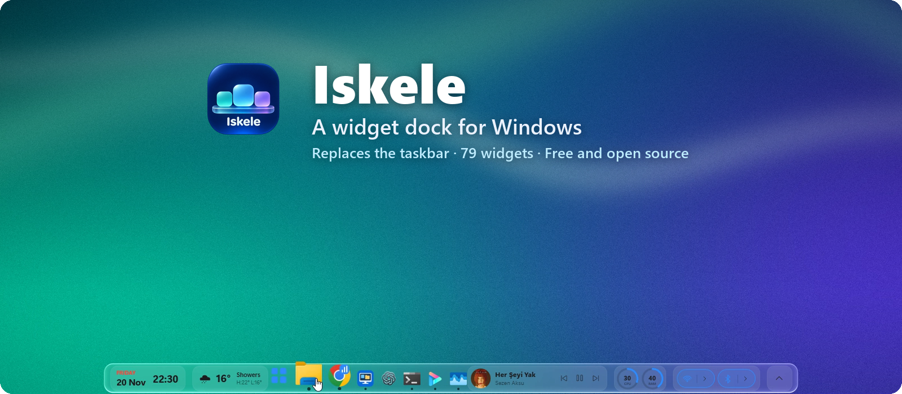
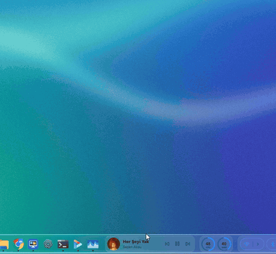
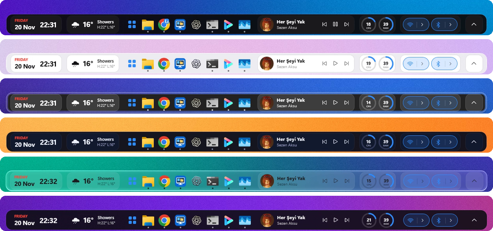
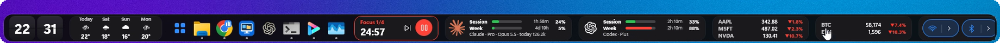
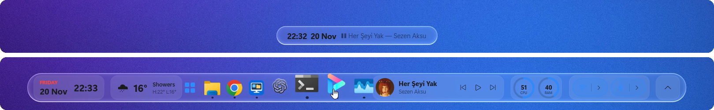
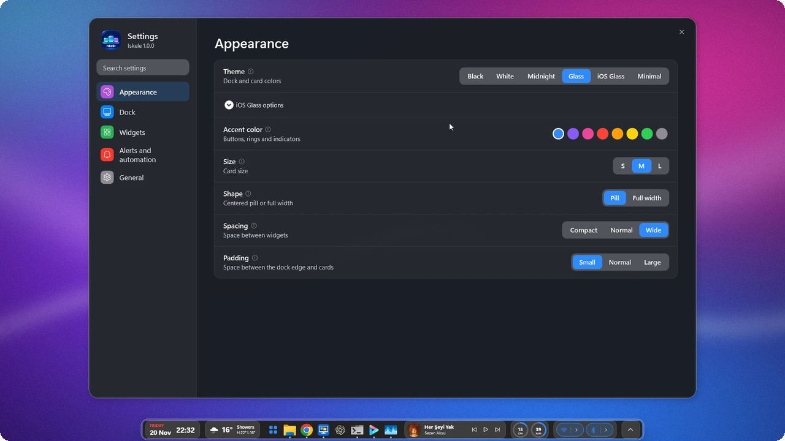
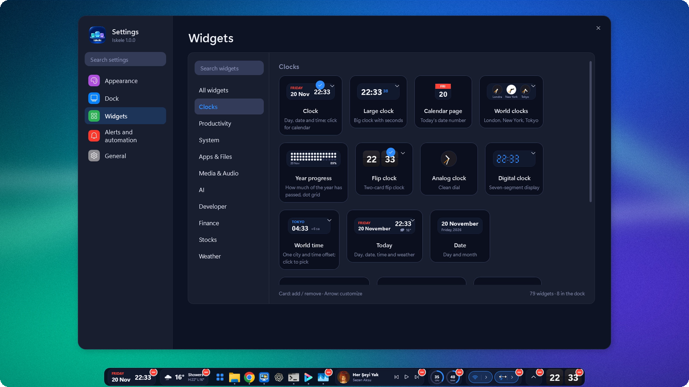

<div align="center">



<br />

**A free, open-source widget dock that replaces the Windows 10/11 taskbar.**

[](https://github.com/iskele-dock/iskele/releases/latest)
[](https://github.com/iskele-dock/iskele/releases)
[](LICENSE)
[](#install)

<a href="https://github.com/iskele-dock/iskele/releases/latest"></a>

[Türkçe](README.md) · **English**

</div>

---

## Why Iskele?

<table>
<tr>
<td width="33%" valign="top">

### 🧩 79 widgets
Clock, weather, music, pomodoro, calendar, CPU/RAM, stocks, crypto, GitHub and **Claude / Codex usage limits** — all in your dock, at a glance.

</td>
<td width="33%" valign="top">

### 🎨 Truly yours
6 themes (including live-refracting **iOS Glass**), 8 accent colors, bar or **balloon** layout, top or bottom edge.

</td>
<td width="33%" valign="top">

### 🔒 Private and lightweight
No account, server, ads or telemetry. No admin rights needed. Your taskbar **always** comes back when you quit.

</td>
</tr>
</table>

## At a glance

<p align="center">
  
  <br /><sub>Smooth, Mac-style magnification</sub>
</p>

<table>
<tr>
<td width="42%" align="center" valign="middle">
  
  <br /><sub>Music panel with cover art, progress and controls</sub>
</td>
<td width="58%" align="center" valign="middle">
  
  <br /><sub>Black · White · Glass · Midnight · iOS Glass · Minimal</sub>
</td>
</tr>
</table>

<p align="center">
  
  <br /><sub>Flip clock · 4-day forecast · pomodoro · Claude and Codex limits · stocks · crypto</sub>
</p>

<p align="center">
  
  <br /><sub><b>Balloon mode:</b> a small floating island that turns into the full dock on hover</sub>
</p>

<table>
<tr>
<td width="50%" align="center"><br /><sub>Theme, color and size change instantly</sub></td>
<td width="50%" align="center"><br /><sub>Widget picker: click to add it to the dock</sub></td>
</tr>
</table>

---

## Install

1. Download `IskeleSetup.exe` from [**iskele-dock.github.io**](https://iskele-dock.github.io/?lang=en) or the [**Releases**](https://github.com/iskele-dock/iskele/releases/latest) page.
2. Run it and click **Install / Update**. The required .NET components are bundled; no admin rights needed.
3. Switch the interface to English under **Ayarlar → Genel → Arayüz dili** (Settings → General → Interface language). The installer itself lets you pick English too.

Iskele installs only for your user account (`%LocalAppData%\Programs\Iskele`) and adds itself to the Start menu. Silent install: `IskeleSetup.exe --silent`

**Updates:** when a new version is out, Iskele lets you know; right-click the dock and choose **Update**.

> [!NOTE]
> **Windows SmartScreen:** the installer is not code-signed, so Windows may show an "Unknown publisher" warning. Click **More info → Run anyway**. You can verify the file with the `.sha256` value on the Releases page:
> ```powershell
> Get-FileHash .\IskeleSetup.exe -Algorithm SHA256
> ```

### Uninstall

- **From Iskele:** Settings → General → **Uninstall Iskele**
- **From Windows:** Settings → Apps → Installed apps → Iskele → Uninstall
- **From the command line:** `%LocalAppData%\Programs\Iskele\IskeleSetup.exe --uninstall`

You will be asked whether to delete your personal settings (notes, screen time, widget layout). The taskbar comes back automatically.

> [!TIP]
> If the taskbar ever stays hidden:
> ```powershell
> & "$env:LOCALAPPDATA\Programs\Iskele\Iskele.exe" --restore
> ```

---

## Features

<details open>
<summary><b>Dock</b></summary>

- **Bar** (a row at the screen edge) or **Balloon** (a floating island that expands on hover) layout.
- Top or bottom edge; pill or full width; size, spacing and padding options.
- Drag to change edges, lock, auto-hide, hide in full screen.
- Registers as a Windows AppBar, so maximized windows never slide under the dock.
- Multiple monitors: main screen, every screen, or follow the cursor.
- Themes: Black, White, Midnight, Glass, iOS Glass (live HLSL refraction) and Minimal; 8 accent colors.
- Turkish and English interface.

</details>

<details open>
<summary><b>Apps</b></summary>

- Start button, pinned apps and open windows; drag to pin and reorder.
- Live window previews, Mac-style magnification, Win+1…0 shortcuts, Win+T keyboard navigation.
- System tray, Wi‑Fi and Bluetooth lists right from the dock.

</details>

<details open>
<summary><b>Widgets (79)</b></summary>

| Group | Examples |
|---|---|
| Clocks (15) | Clock and calendar, flip / analog / 7-segment clocks, world clocks, day/month/year progress |
| Productivity (9) | Screen time, pomodoro, timer, stopwatch, to-dos, notes, calendar (iCal) |
| System (25) | CPU, RAM, network, battery, brightness, keyboard language, light/dark theme, keep awake, notifications |
| Apps & Files (6) | Storage, recycle bin, recent files, search & run, screenshot |
| Media & Audio (6) | Now playing (4 sizes), volume, microphone |
| Weather (6) | Current conditions, hourly, daily forecast, sunrise & sunset |
| AI (5) | Claude, ChatGPT/Codex, Gemini, OpenCode usage limits |
| Developer (3) | GitHub notifications, PRs, contribution grid |
| Finance / Stocks (4) | Currency converter, crypto, stock list and chart |

Right-click the dock and choose **Edit widgets…** to add, remove and reorder widgets.

</details>

## Privacy

| Data | Source |
|---|---|
| Weather | [Open‑Meteo](https://open-meteo.com) (no key needed) |
| Currency | open.er-api.com |
| Crypto | Binance public API |
| Stocks | Yahoo Finance |
| Calendar | The private iCal address you paste into Settings |
| GitHub | `gh auth token` on your PC (kept in memory only) |
| AI limits | Local files (`~/.claude`, `~/.codex`, …); Claude limits are requested only from Anthropic, using your Claude Code sign-in |
| Update check | GitHub (latest version info only; can be turned off under Settings → General → Updates) |

- Only widgets shown in the dock make network requests.
- Iskele has no server, account, ads or telemetry. Settings and data stay on your PC (`%AppData%\Iskele`).
- Error reports are never sent automatically; Settings → Feedback only saves them to your PC.

## Your taskbar always comes back

1. **Before** touching the taskbar, its original state is written to `%AppData%\Iskele\taskbar-state.txt`.
2. It is restored on normal exit, on unhandled errors and on process shutdown.
3. A separate **watchdog process** monitors Iskele; even if it crashes or is killed from Task Manager, the taskbar comes back.
4. Any leftover state is restored on the next launch, on install and on uninstall.
5. In an emergency, `Iskele.exe --restore` always brings the taskbar back.

With the default settings Iskele writes no permanent Windows settings and never moves your desktop icons. Only if you choose *Taskbar space: Use* in Settings does it turn on Windows' "auto-hide" option, which is reverted when you quit.

---

## Build from source

Requirements: Windows 10 (19041) or later, [.NET 9 SDK](https://dotnet.microsoft.com/download/dotnet/9.0).

```powershell
git clone https://github.com/iskele-dock/iskele.git
cd iskele

# Run
dotnet run --project src

# Build the installer → dist\IskeleSetup-<version>.exe
./installer/build.ps1
```

More details, test flags and the project layout (in Turkish): [docs/GELISTIRME.md](docs/GELISTIRME.md).

## Contributing

Use [Issues](https://github.com/iskele-dock/iskele/issues) for bug reports and ideas. See [CONTRIBUTING.md](CONTRIBUTING.md) for code contributions.

## License

Iskele is released under the [GNU GPL v3](LICENSE). Third-party components and their licenses: [THIRD-PARTY-NOTICES.md](THIRD-PARTY-NOTICES.md).

<sub>Claude, ChatGPT/Codex, Gemini, OpenCode, GitHub and other product names and logos belong to their owners and are used only to identify the related widget. Iskele is not affiliated with these companies. The album cover and song title shown in the screenshots belong to their owners and are shown only to illustrate the music widget.</sub>
