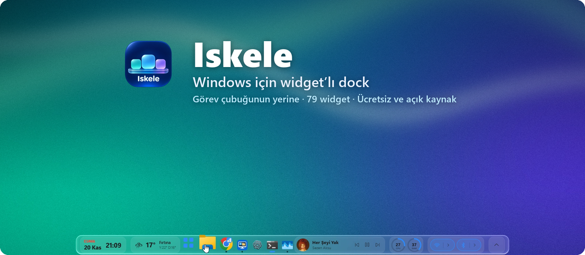
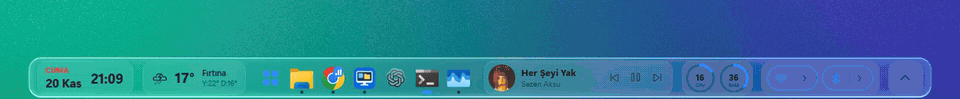
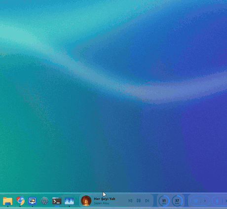
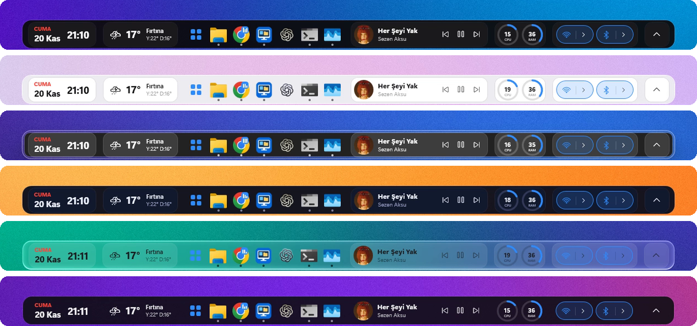
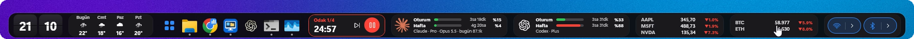
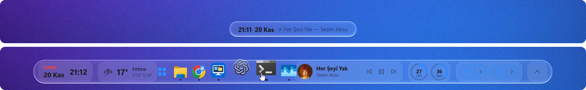
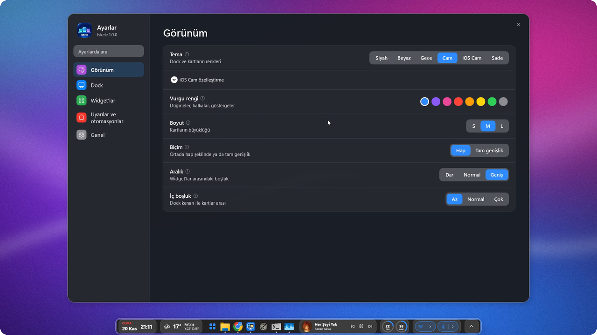
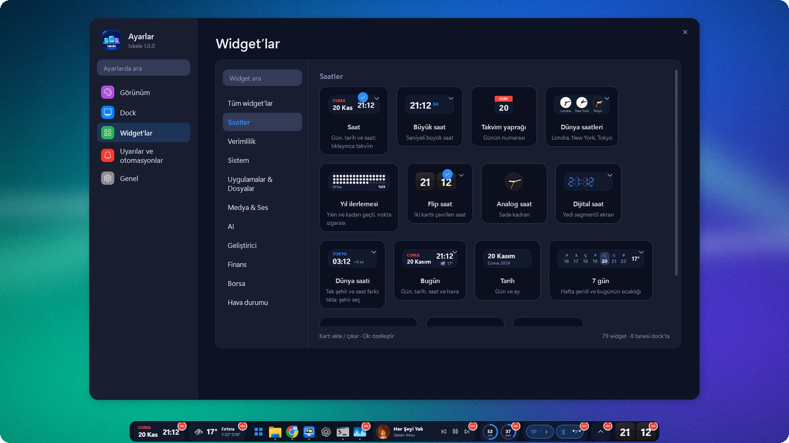

<div align="center">



<br />

**Windows 10/11 görev çubuğunun yerine geçen, widget'lı, tamamen ücretsiz ve açık kaynak bir dock.**

[](https://github.com/iskele-dock/iskele/releases/latest)
[](https://github.com/iskele-dock/iskele/releases)
[](LICENSE)
[](#kurulum)

<a href="https://github.com/iskele-dock/iskele/releases/latest"></a>

**Türkçe** · [English](README.en.md)

</div>

---

## Neden Iskele?

<table>
<tr>
<td width="33%" valign="top">

### 🧩 79 widget
Saat, hava durumu, müzik, pomodoro, takvim, CPU/RAM, borsa, kripto, GitHub ve **Claude / Codex limitleri** — hepsi dock'ta, bir bakışta.

</td>
<td width="33%" valign="top">

### 🎨 Tamamen sizin
6 tema (canlı kırılmalı **iOS Cam** dahil), 8 vurgu rengi, şerit ya da **balon** yerleşimi, alt ya da üst kenar.

</td>
<td width="33%" valign="top">

### 🔒 Güvenli ve hafif
Hesap, sunucu, reklam ya da telemetri yok. Yönetici izni gerekmez. Kapatınca görev çubuğu **her zaman** geri gelir.

</td>
</tr>
</table>

## Bir bakışta

<p align="center">
  
  <br /><sub>Mac tarzı akıcı büyütme</sub>
</p>

<table>
<tr>
<td width="42%" align="center" valign="middle">
  
  <br /><sub>Kapak, ilerleme ve kontrollerle müzik paneli</sub>
</td>
<td width="58%" align="center" valign="middle">
  
  <br /><sub>Siyah · Beyaz · Cam · Gece · iOS Cam · Sade</sub>
</td>
</tr>
</table>

<p align="center">
  
  <br /><sub>Flip saat · 4 günlük tahmin · pomodoro · Claude ve Codex limitleri · borsa · kripto</sub>
</p>

<p align="center">
  
  <br /><sub><b>Balon modu:</b> ekranın ortasında küçük bir ada; üzerine gelince dock'a dönüşür</sub>
</p>

<table>
<tr>
<td width="50%" align="center"><br /><sub>Tema, renk ve boyut anında değişir</sub></td>
<td width="50%" align="center"><br /><sub>Widget seçici: tıkla, dock'a eklensin</sub></td>
</tr>
</table>

---

## Kurulum

1. [**iskele-dock.github.io**](https://iskele-dock.github.io) adresinden ya da [**Releases**](https://github.com/iskele-dock/iskele/releases/latest) sayfasından `IskeleSetup.exe` dosyasını indirin.
2. Çalıştırıp **Kur / Güncelle** düğmesine basın. Gerekli .NET bileşenleri pakete dahildir; yönetici izni gerekmez.

Iskele yalnızca sizin kullanıcı hesabınıza (`%LocalAppData%\Programs\Iskele`) kurulur ve Başlat menüsüne eklenir. Sessiz kurulum: `IskeleSetup.exe --silent`

**Güncellemeler:** Yeni sürüm çıktığında Iskele haber verir; dock'a sağ tıklayıp **Güncelle**'yi seçmeniz yeterli.

> [!NOTE]
> **Windows SmartScreen uyarısı:** Kurulum dosyası dijital olarak imzalı olmadığı için "Bilinmeyen yayımcı" uyarısı çıkabilir. **Ek bilgi → Yine de çalıştır** ile devam edin. Dosyanın değişmediğini Releases sayfasındaki `.sha256` değeriyle doğrulayabilirsiniz:
> ```powershell
> Get-FileHash .\IskeleSetup.exe -Algorithm SHA256
> ```

### Kaldırma

- **Iskele içinden:** Ayarlar → Genel → **Iskele'yi kaldır**
- **Windows'tan:** Ayarlar → Uygulamalar → Yüklü uygulamalar → Iskele → Kaldır
- **Komutla:** `%LocalAppData%\Programs\Iskele\IskeleSetup.exe --uninstall`

Kişisel ayarlarınızın (notlar, ekran süresi, widget düzeni) silinip silinmeyeceği sorulur. Görev çubuğu otomatik olarak geri gelir.

> [!TIP]
> Görev çubuğu herhangi bir nedenle geri gelmezse:
> ```powershell
> & "$env:LOCALAPPDATA\Programs\Iskele\Iskele.exe" --restore
> ```

---

## Özellikler

<details open>
<summary><b>Dock</b></summary>

- **Şerit** (ekran kenarında satır) ya da **Balon** (ekranın ortasında yüzen, üzerine gelince açılan ada) yerleşimi.
- Alt ya da üst kenar; hap ya da tam genişlik; boyut, aralık ve iç boşluk ayarları.
- Sürükleyerek kenar değiştirme, kilitleme, otomatik gizleme, tam ekranda gizlenme.
- Windows'a AppBar olarak kaydolur; büyütülmüş pencereler dock'un altına girmez.
- Birden çok monitör: ana ekran, her ekran ya da imleci takip et.
- Temalar: Siyah, Beyaz, Gece, Cam, iOS Cam (HLSL ile canlı kırılmalı cam) ve Sade; 8 vurgu rengi.
- Türkçe ve İngilizce arayüz (Ayarlar → Genel → Arayüz dili).

</details>

<details open>
<summary><b>Uygulamalar</b></summary>

- Başlat düğmesi, sabitlenmiş uygulamalar ve açık pencereler; sürükleyerek sabitleme ve sıralama.
- Canlı pencere önizlemeleri, Mac tarzı büyütme, Win+1…0 kısayolları, Win+T ile klavyeyle gezinme.
- Sistem tepsisi, Wi‑Fi ve Bluetooth listeleri doğrudan dock'tan.

</details>

<details open>
<summary><b>Widget'lar (79)</b></summary>

| Grup | Örnekler |
|---|---|
| Saatler (15) | Saat ve takvim, flip / analog / 7 segment saat, dünya saatleri, gün/ay/yıl ilerlemesi |
| Verimlilik (9) | Ekran süresi, pomodoro, zamanlayıcı, kronometre, yapılacaklar, notlar, takvim (iCal) |
| Sistem (25) | CPU, RAM, ağ, pil, parlaklık, klavye dili, açık/koyu tema, uyanık tut, bildirimler |
| Uygulamalar & Dosyalar (6) | Depolama, geri dönüşüm kutusu, son açılanlar, ara & çalıştır, ekran görüntüsü |
| Medya & Ses (6) | Şimdi çalan (4 boyut), ses, mikrofon |
| Hava durumu (6) | Anlık durum, saatlik, günlük tahmin, gün doğumu & batımı |
| AI (5) | Claude, ChatGPT/Codex, Gemini, OpenCode kullanım limitleri |
| Geliştirici (3) | GitHub bildirimleri, PR'lar, katkı ızgarası |
| Finans / Borsa (4) | Döviz çevirici, kripto, borsa listesi ve grafiği |

Dock'a sağ tıklayıp **Widget'ları düzenle…** ile widget ekleyip çıkarabilir, sürükleyerek sıralayabilirsiniz.

</details>

## Gizlilik

| Veri | Kaynak |
|---|---|
| Hava durumu | [Open‑Meteo](https://open-meteo.com) (anahtar gerekmez) |
| Döviz | open.er-api.com |
| Kripto | Binance herkese açık API |
| Borsa | Yahoo Finance |
| Takvim | Ayarlar'a yapıştırdığınız gizli iCal adresi |
| GitHub | Bilgisayarınızdaki `gh auth token` (yalnızca bellekte tutulur) |
| AI limitleri | Yerel dosyalar (`~/.claude`, `~/.codex` vb.); Claude limitleri için yalnızca Anthropic'e, Claude Code oturumunuzla sorulur |
| Güncelleme denetimi | GitHub (yalnızca son sürüm bilgisi; Ayarlar → Genel → Güncellemeler'den kapatılabilir) |

- Yalnızca dock'ta gösterilen widget'lar ağ isteği yapar.
- Iskele'nin kendi sunucusu, hesabı, reklamı ya da telemetrisi yoktur. Ayarlar ve veriler yalnızca bilgisayarınızda (`%AppData%\Iskele`) tutulur.
- Hata raporları otomatik gönderilmez; Ayarlar → Geri bildirim ile yalnızca bilgisayarınıza kaydedilir.

## Görev çubuğu her zaman geri gelir

1. Görev çubuğuna dokunmadan **önce** özgün durum `%AppData%\Iskele\taskbar-state.txt` dosyasına yazılır.
2. Normal çıkışta, yakalanmamış hatada ve süreç kapanışında geri yüklenir.
3. Ayrı bir **bekçi süreç** ana süreci izler; ana süreç çökse ya da Görev Yöneticisi'nden sonlandırılsa bile görev çubuğu geri gelir.
4. Bir sonraki açılışta, kurulumda ve kaldırmada kalmış bir durum varsa önce o geri yüklenir.
5. Acil durumda `Iskele.exe --restore` görev çubuğunu her koşulda geri getirir.

Varsayılan ayarlarla Iskele Windows'a kalıcı bir ayar yazmaz ve masaüstü simgelerinizi yerinden oynatmaz. Yalnızca Ayarlar'da *Görev çubuğu alanı: Kullan* seçilirse Windows'un "otomatik gizle" ayarı açılır; çıkışta eski haline getirilir.

---

## Kaynaktan derleme

Gerekenler: Windows 10 (19041) veya üstü, [.NET 9 SDK](https://dotnet.microsoft.com/download/dotnet/9.0).

```powershell
git clone https://github.com/iskele-dock/iskele.git
cd iskele

# Çalıştır
dotnet run --project src

# Kurulum dosyasını üret → dist\IskeleSetup-<sürüm>.exe
./installer/build.ps1
```

Ayrıntılar, test bayrakları ve proje yapısı: [docs/GELISTIRME.md](docs/GELISTIRME.md).

## Katkı

Hata bildirimleri ve öneriler için [Issues](https://github.com/iskele-dock/iskele/issues) sayfasını kullanabilirsiniz. Kod katkısı için [CONTRIBUTING.md](CONTRIBUTING.md) dosyasına göz atın.

## Lisans

Iskele [GNU GPL v3](LICENSE) lisansıyla dağıtılır. Üçüncü taraf bileşenler ve lisansları: [THIRD-PARTY-NOTICES.md](THIRD-PARTY-NOTICES.md).

<sub>Claude, ChatGPT/Codex, Gemini, OpenCode, GitHub ve diğer ürün adları ile logoları sahiplerine aittir; yalnızca ilgili widget'ı tanımlamak için kullanılır. Iskele bu şirketlerle bağlantılı değildir. Ekran görüntülerinde görünen albüm kapağı ve şarkı adı sahiplerine aittir ve yalnızca müzik widget'ını göstermek içindir.</sub>
