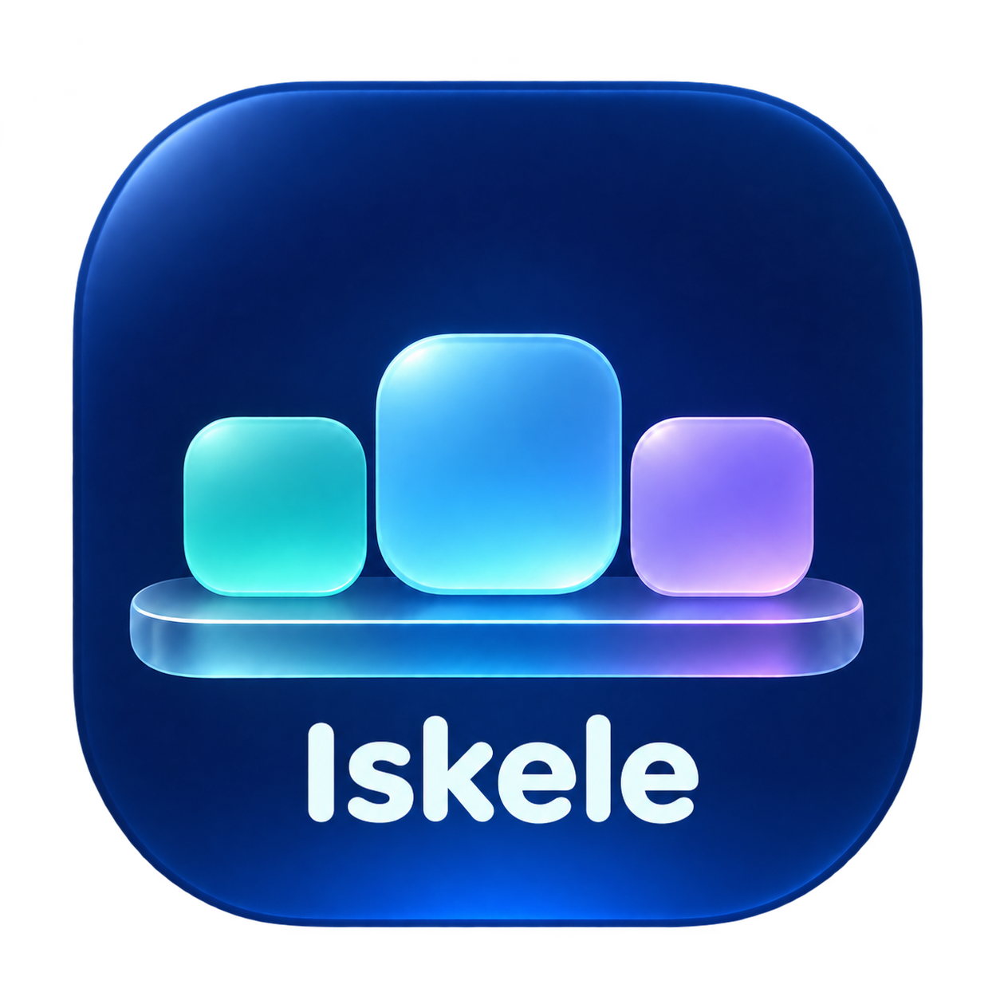
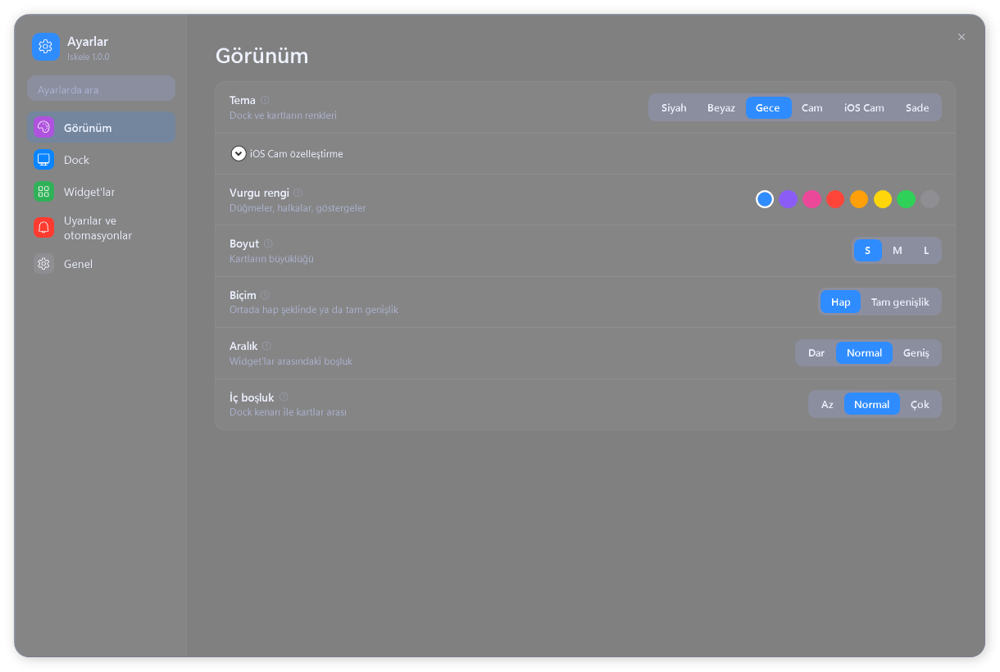

# Iskele



**Windows 10/11 için görev çubuğunun yerine geçen, widget'lı, açık kaynak bir dock.**

Ekranın alt ya da üst kenarına yapışır, Windows görev çubuğunu gizler; kapatınca her şey eski haline döner. Saat, hava durumu, sistem göstergeleri, müzik, yapılacaklar, takvim, borsa ve daha fazlası için **79 widget** içerir.


- Yönetici izni, hesap ya da Iskele sunucusu **gerekmez**.
- Ayarlar ve veriler yalnızca bilgisayarınızda (`%AppData%\Iskele`) tutulur; telemetri yoktur.
- Görev çubuğu **her zaman geri gelir**: uygulama çökse bile ayrı bir bekçi süreç onu geri getirir.

> English: Iskele is an open-source, widget-based dock that replaces the Windows 10/11 taskbar. The interface is available in Turkish and English (Settings → General → Interface language).

---

## İndirme ve kurulum

1. [**Releases**](../../releases/latest) sayfasından `IskeleSetup-1.0.0.exe` dosyasını indirin.
2. Gerekli .NET bileşenleri pakete dahildir; ayrıca .NET kurmanız gerekmez.
3. `IskeleSetup-1.0.0.exe` dosyasını çalıştırıp **Kur / Güncelle** düğmesine basın.

Iskele yalnızca sizin kullanıcı hesabınıza (`%LocalAppData%\Programs\Iskele`) kurulur ve Başlat menüsüne eklenir.

> **Windows SmartScreen uyarısı:** Kurulum dosyası dijital olarak imzalı olmadığı için Windows "Bilinmeyen yayımcı" uyarısı gösterebilir. **Ek bilgi → Yine de çalıştır** ile devam edebilirsiniz. Dosyanın değişmediğini Releases sayfasındaki `.sha256` değeriyle doğrulayabilirsiniz:
>
> ```powershell
> Get-FileHash .\IskeleSetup-1.0.0.exe -Algorithm SHA256
> ```

Sessiz kurulum: `IskeleSetup-1.0.0.exe --silent`

## Kaldırma

Üç yoldan biri yeterlidir:

- **Iskele içinden:** Ayarlar → Genel → **Iskele'yi kaldır**
- **Windows'tan:** Ayarlar → Uygulamalar → Yüklü uygulamalar → Iskele → Kaldır
- **Komutla:** `%LocalAppData%\Programs\Iskele\IskeleSetup.exe --uninstall`

Kaldırırken kişisel ayarlarınızın (notlar, ekran süresi, widget düzeni) da silinip silinmeyeceği sorulur. Görev çubuğu otomatik olarak geri gelir.

Görev çubuğu herhangi bir nedenle geri gelmezse:

```powershell
& "$env:LOCALAPPDATA\Programs\Iskele\Iskele.exe" --restore
```

---

## Özellikler

### Dock

- **Şerit** (ekran kenarında satır) ya da **Balon** (ekranın ortasında yüzen, üzerine gelince açılan ada) yerleşimi.
- Alt ya da üst kenar; hap ya da tam genişlik; boyut, aralık ve iç boşluk ayarları.
- Sürükleyerek kenar değiştirme, kilitleme, otomatik gizleme, tam ekranda gizlenme.
- Windows'a AppBar olarak kaydolur; büyütülmüş pencereler dock'un altına girmez.
- Birden çok monitör: ana ekran, her ekran ya da imleci takip et.
- Temalar: Siyah, Beyaz, Gece, Cam, iOS Cam (HLSL ile canlı kırılmalı cam) ve Sade; 8 vurgu rengi.

### Uygulamalar

- Başlat düğmesi, sabitlenmiş uygulamalar ve açık pencereler; sürükleyerek sabitleme ve sıralama.
- Canlı pencere önizlemeleri, Mac tarzı büyütme, Win+1…0 kısayolları, Win+T ile klavyeyle gezinme.
- Sistem tepsisi, Wi‑Fi ve Bluetooth listeleri doğrudan dock'tan.

### Widget'lar (79)

| Grup | Örnekler |
|---|---|
| Saatler (15) | Saat ve takvim, flip / analog / 7 segment saat, dünya saatleri, gün/ay/yıl ilerlemesi |
| Verimlilik (9) | Ekran süresi, pomodoro, zamanlayıcı, kronometre, yapılacaklar, notlar, takvim (iCal) |
| Sistem (25) | CPU, RAM, ağ, pil, parlaklık, klavye dili, açık/koyu tema, uyanık tut, bildirimler |
| Uygulamalar & Dosyalar (6) | Depolama, geri dönüşüm kutusu, son açılanlar, ara & çalıştır, ekran görüntüsü |
| Medya & Ses (6) | Şimdi çalan (4 boyut), ses, mikrofon |
| Hava durumu (6) | Anlık durum, saatlik, günlük tahmin, gün doğumu & batımı |
| AI (5) | Claude, ChatGPT/Codex, Gemini, OpenCode kullanım limitleri |
| Geliştirici (3) | GitHub bildirimleri, PR'lar, katkı ızgarası |
| Finans / Borsa (4) | Döviz çevirici, kripto, borsa listesi ve grafiği |

Dock'a sağ tıklayıp **Widget'ları düzenle…** ile widget ekleyip çıkarabilir, sürükleyerek sıralayabilirsiniz.



## Gizlilik: veriler nereden gelir?

| Veri | Kaynak |
|---|---|
| Hava durumu | [Open‑Meteo](https://open-meteo.com) (anahtar gerekmez) |
| Döviz | open.er-api.com |
| Kripto | Binance herkese açık API |
| Borsa | Yahoo Finance |
| Takvim | Ayarlar'a yapıştırdığınız gizli iCal adresi |
| GitHub | Bilgisayarınızdaki `gh auth token` (yalnızca bellekte tutulur) |
| AI limitleri | Yalnızca yerel dosyalar (`~/.claude`, `~/.codex` vb.); hiçbir yere istek atılmaz |

- Yalnızca dock'ta gösterilen widget'lar ağ isteği yapar.
- Iskele'nin kendi sunucusu, hesabı, reklamı ya da telemetrisi yoktur.
- Hata raporları otomatik gönderilmez; Ayarlar → Geri bildirim ile yalnızca bilgisayarınıza kaydedilir.

## Güvenlik: görev çubuğu her zaman geri gelir

1. Görev çubuğuna dokunmadan **önce** özgün durum `%AppData%\Iskele\taskbar-state.txt` dosyasına yazılır.
2. Normal çıkışta, yakalanmamış hatada ve süreç kapanışında geri yüklenir.
3. Ayrı bir **bekçi süreç** ana süreci izler; ana süreç çökse ya da Görev Yöneticisi'nden sonlandırılsa bile görev çubuğu geri gelir.
4. Bir sonraki açılışta artık kalmış bir durum dosyası varsa önce o temizlenir.
5. Acil durumda `Iskele.exe --restore` görev çubuğunu her koşulda geri getirir.

---

## Kaynaktan derleme

Gerekenler: Windows 10 (19041) veya üstü, [.NET 9 SDK](https://dotnet.microsoft.com/download/dotnet/9.0).

```powershell
git clone <bu-deponun-adresi>
cd iskele

# Çalıştır
dotnet run --project src

# Kurulum dosyasını üret → dist\IskeleSetup-<sürüm>.exe
./installer/build.ps1
```

Ayrıntılar, test bayrakları ve proje yapısı: [docs/GELISTIRME.md](docs/GELISTIRME.md).

## Katkı

Hata bildirimleri ve öneriler için [Issues](../../issues) sayfasını kullanabilirsiniz. Kod katkısı için [CONTRIBUTING.md](CONTRIBUTING.md) dosyasına göz atın.

## Lisans

Iskele [GNU GPL v3](LICENSE) lisansıyla dağıtılır. Üçüncü taraf bileşenler ve lisansları: [THIRD-PARTY-NOTICES.md](THIRD-PARTY-NOTICES.md).

Claude, ChatGPT/Codex, Gemini, OpenCode, GitHub ve diğer ürün adları ile logoları sahiplerine aittir; yalnızca ilgili widget'ı tanımlamak için kullanılır. Iskele bu şirketlerle bağlantılı değildir.
